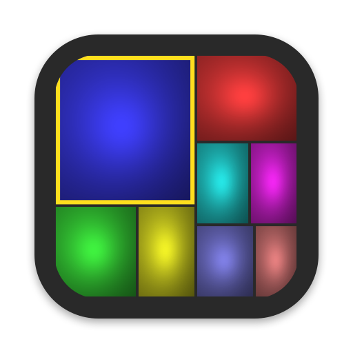
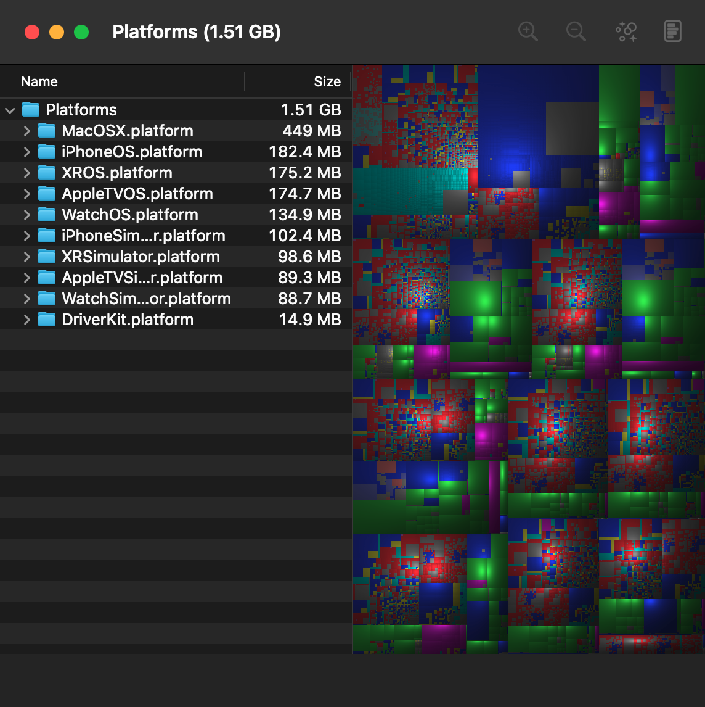

<p align="center">
  
</p>

<h1 align="center">DiskInventory</h1>

<p align="center">
  See what fills your Mac's disk: a file outline next to a cushion treemap, where every file is a shaded tile sized by its disk use.
</p>

<p align="center">
  <a href="https://github.com/desaroxx/disk-inventory/releases/latest"><b>Download the latest release</b></a>
  · macOS 15 or later · Apple silicon and Intel
</p>

<p align="center">
  
</p>

DiskInventory is a modern, native reimplementation of
[Disk Inventory X](http://www.derlien.com/) by Tjark Derlien, rewritten from scratch in Swift
and SwiftUI. See [Credits](#credits).

## Features

- **Volumes window** lists your drives with their usage. You can also open any folder, volume or app bundle.
- **Fast scanning**: a parallel walk with `getattrlistbulk(2)` measures physical and logical sizes. It counts hard links once, and it does not follow symlinks or cross onto other volumes.
- **Treemap**: a squarified layout with cushion shading, so you can see the folder structure. Selection stays in sync with the file outline. Zoom in on a folder, or zoom back out to any parent level.
- **File kind statistics** colour the twelve largest file kinds and show the size and file count of each kind.
- **Cleanup suggestions** find space that is usually safe to reclaim (see [below](#cleanup-suggestions)).
- Selection list, Information panel, free and other space tiles, package contents, horizontal split, and Reveal in Finder, Open With and Move to Trash.

## Install

1. Download `DiskInventory-<version>.dmg` from the [Releases page](https://github.com/desaroxx/disk-inventory/releases/latest).
2. Open the DMG and drag **DiskInventory** to **Applications**.
3. The app is not notarized yet, so macOS blocks the first launch. Right-click the app, choose **Open**, then confirm. Or allow the app in **System Settings ▸ Privacy & Security**.
4. Optional: to scan protected folders such as `~/Library`, give DiskInventory **Full Disk Access** in **System Settings ▸ Privacy & Security**.

Each release also includes a zip of the app and a `SHA256SUMS.txt` file to verify the downloads.

## Cleanup suggestions

To see the suggestions, click **Cleanup** in the toolbar or choose **Window ▸ Show Cleanup Suggestions**. The list shows space that is usually safe to reclaim:

- Xcode DerivedData and device support files
- simulator caches
- the folder of each app in `~/Library/Caches`
- `node_modules`, `.build` and `target` folders that sit next to their project file
- installers and old large files in `~/Downloads`

Each suggestion is marked **Safe** (it rebuilds itself) or **Check first**. Ticked items are highlighted in the treemap. After you confirm, they all go to the Trash together, so Finder's **Put Back** can restore them.

## Build from source

You need Xcode 26 or later (Swift 6).

```sh
swift run DiskInventory                    # launch; the Volumes window lists drives
swift run DiskInventory -open ~/Downloads  # scan a folder immediately
swift test                                 # run the core tests
scripts/build-app.sh                       # build dist/DiskInventory.app, a DMG and a zip
```

Use `-open <path>`, not a bare path. An executable without an app bundle treats a bare path
as an open-file request and ignores it.

`scripts/build-app.sh` builds a universal app and signs it ad hoc. To make a signed and
notarized build, set `SIGN_IDENTITY` to a Developer ID Application identity and set
`NOTARY_PROFILE` to the name of a profile that you saved with `xcrun notarytool store-credentials`.

### Releasing

1. Update `VERSION` and add a section for the new version to `CHANGELOG.md`.
2. Commit the changes. Then tag the commit and push the tag:

   ```sh
   git tag v1.2.0 && git push origin v1.2.0
   ```

The [Release workflow](.github/workflows/release.yml) runs the tests and builds the DMG and the zip. Then it publishes a GitHub release, with the release notes taken from `CHANGELOG.md`.

### Checking the UI without clicking

`DI_SNAPSHOT=/tmp/shot` saves a PNG of every window when the first folder finishes loading.
`DI_SCRIPT` then runs steps on that folder and saves the windows again after each step. For example:

```sh
DI_SNAPSHOT=/tmp/shot DI_SCRIPT=selectLargestFile,kinds,list,info,zoomIn,zoomOut \
  swift run DiskInventory -open ~/Downloads
```

The available steps are `selectLargestFile selectParent hoverSelection zoomIn zoomOut kinds list info
packages logical free other split cleanup tickSafe`. The `tickSafe` step also logs the top suggestions.
The app quits when the script ends.

### Layout

| Path | What |
|---|---|
| `docs/SPEC.md` | Clean-room behaviour spec of Disk Inventory X, taken only from its shipped resources. |
| `Sources/DiskInventoryCore/Scanner.swift` | Parallel `getattrlistbulk(2)` walk: physical and logical sizes, each hard link counted once, no symlinks followed, no other volumes. |
| `Sources/DiskInventoryCore/FileNode.swift` | Immutable size tree with parent links. An edit rebuilds the node's ancestors. |
| `Sources/DiskInventoryCore/FileKinds.swift` | Finder kinds per extension, kind statistics and the 12-colour kind palette. |
| `Sources/DiskInventoryCore/TreemapLayout.swift` | Squarified layout with cushion surfaces. Tiny files are pooled per folder. |
| `Sources/DiskInventoryCore/CleanupRules.swift` | Cleanup rules and the walk that finds their candidates. |
| `Sources/DiskInventoryCore/CushionRenderer.swift` | Shades the tiles into a bitmap. |
| `Sources/DiskInventory/` | The app: windows, files view, treemap view, panels, menus and preferences. |
| `Resources/` | `Info.plist`, app icon and About-box credits for the app bundle. |
| `scripts/` | `build-app.sh` (app, DMG and zip) and `make-icon.swift` (draws the icon). |
| `Tests/DiskInventoryCoreTests/` | Core tests. |

## Credits

DiskInventory is inspired by **[Disk Inventory X](http://www.derlien.com/)** by **Tjark Derlien**,
the classic Mac disk usage tool. DiskInventory reproduces Disk Inventory X's
behaviour and layout as a native app for current versions of macOS.

DiskInventory is a clean-room reimplementation. [`docs/SPEC.md`](docs/SPEC.md) describes the original
app's behaviour, taken only from its shipped resources: Interface Builder files, property lists, strings
and help. No source code of the original was read or copied. DiskInventory is an independent project.
It is not affiliated with or endorsed by Tjark Derlien or Disk Inventory X.

The cushion treemap technique comes from *Cushion Treemaps* by Jarke J. van Wijk and Huub van de
Wetering (1999). The squarified layout comes from *Squarified Treemaps* by Mark Bruls, Kees Huizing and
Jarke J. van Wijk (2000).

## License

[MIT](LICENSE) © 2026 Ken Steiner
